# AI Video Studio Kit

Make short AI films (brand films, UGC ads, music videos) from a script to a finished cut, with a person approving every
step before any money is spent on the next one.

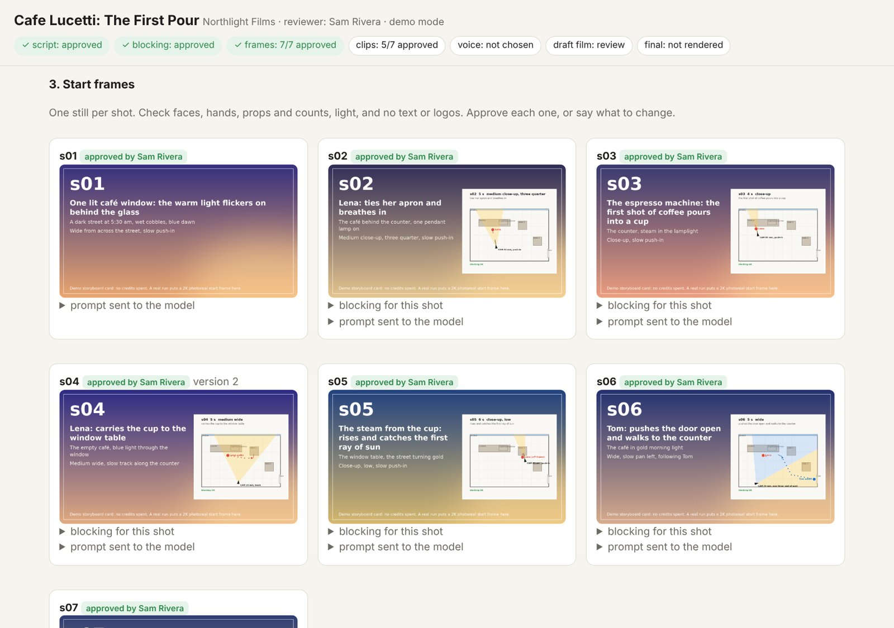

You write the script, the kit checks it, draws a top-view plan of who stands and walks where, makes the start frames,
renders several video takes per shot, checks every take for typical AI defects, records the narration and the score, and
cuts the film. Between every step you approve or send back each item on a review page, and your note goes straight into
the next prompt.

> **Private software, owned by Giovanni Brees.** You may install and use this kit to make your own videos while you
> have access to this repository. Copying, sharing, publishing or reselling it is not allowed. See [LICENSE](LICENSE).

---

## Real examples

These frames and clips were made with this workflow for a music video, and each one passed review before it went into
the cut.

### Start frames

| | | |
|---|---|---|
|  | 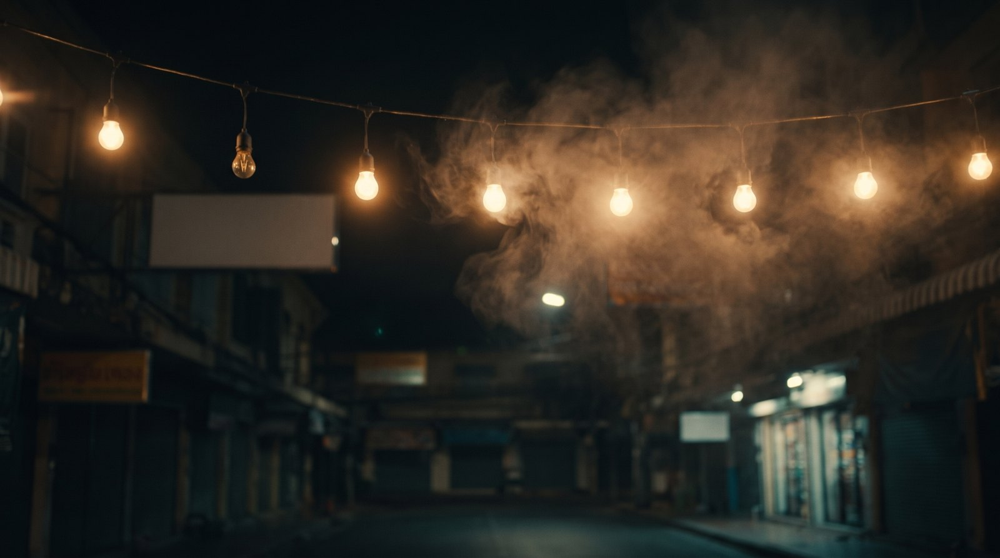 |  |
| **Golden hour, close on colorful tassels and pompoms hanging.** Start frame, reviewer PASS. Video motion: the tassels swing as the tuk-tuk rolls gently, the flare pulses; camera fixed to the tuk-tuk. Remade without people or signs. | **Night, smoke rising through a string of bare light bulbs.** Start frame, reviewer PASS. Video motion: smoke rises up through the bulbs; static camera. Remade without people or signs. | **Night, grilled squid and skewers on a hot grill under a single bulb.** Start frame, reviewer PASS. Video motion: smoke rises in curls under the bulb, the grill glows; static camera. Background signs blank. |
|  |  |  |
| **Day, a narrow canal-side walkway lined with potted plants.** Start frame, reviewer PASS. Video motion: hyperlapse forward along the walkway, plants and house fronts streaming past on both sides; the walkway stays continuous. No people or signs. | **Day, extreme close-up of a long-tail boat propeller churning.** Start frame, reviewer PASS. Video motion: the propeller spins and throws sparkling spray; the camera holds steady beside it. Remade without people or signs. | **Day, an old banyan tree wrapped with colorful ribbons.** Start frame, reviewer PASS. Video motion: the ribbons flutter in the wind, leaves sway; static camera. No people or text. |

### Video clips

| | | |
|---|---|---|
| [](docs/examples/clip_C75.mp4) | [](docs/examples/clip_C88.mp4) | [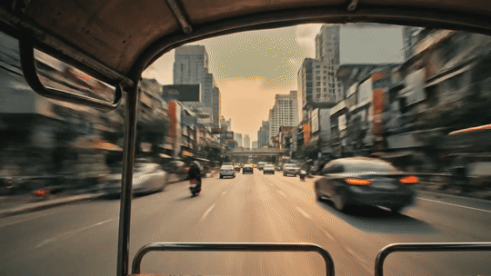](docs/examples/clip_C01.mp4) |
| **Golden hour tassels.** The tassels swing as the tuk-tuk rolls, the flare pulses; camera fixed to the tuk-tuk. Veo 720p, reviewer PASS. | **Night, camera pointing down at a puddle reflecting pink and blue neon.** Rain drops hit the puddle, rings spreading and colors rippling; static close camera. Remade without people or signs, reviewer PASS. | **Tuk-tuk point of view, one-way avenue (re-roll).** Re-rolled after review so all traffic moves one way, then trimmed to 2.5 s before the street starts to change. Veo 720p, reviewer PASS. |
| [](docs/examples/clip_C13.mp4) | [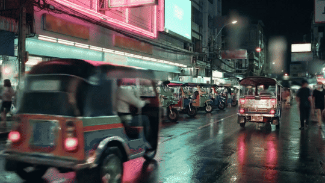](docs/examples/clip_C22.mp4) | [](docs/examples/clip_C23.mp4) |
| **Clouds racing over the towers.** A clean time-lapse. Veo 720p, reviewer PASS. | **A row of tuk-tuks in neon, one pulls out.** The first 1.0 s was trimmed because a second tuk-tuk merged into it. Veo 720p, reviewer PASS (marginal). | **Drone over a park lake with towers behind.** A clean slow push. Veo 720p, reviewer PASS. |

Click a clip to open the full-quality MP4. Each one started as an approved start frame, went through several takes,
the clip check and a human review, exactly as described below.

---

## Contents
1. [Real examples](#real-examples)
2. [How it works](#how-it-works)
3. [Install](#install)
4. [Your first project](#your-first-project)
5. [Step by step](#step-by-step)
6. [What it costs](#what-it-costs)
7. [The script format](#the-script-format)
8. [The extra tools](#the-extra-tools)
9. [Folder layout](#folder-layout)
10. [Troubleshooting](#troubleshooting)

---

## How it works

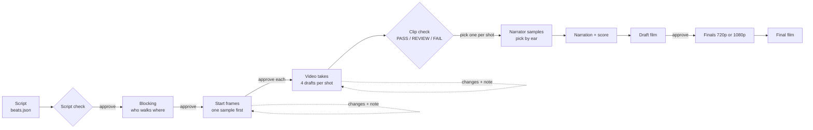

| Gate | What you look at | What it protects |
|---|---|---|
| Script | brief, signed promise, three concepts, the shot table, the script check | Nothing is generated from a script nobody agreed to |
| Blocking | a top-view drawing per shot | People walking through tables, actors out of frame |
| Frames | one still per shot, one sample before the batch | Paying for 20 frames from a prompt that is wrong |
| Clips | several takes per shot with defect flags | Pop-ins, morphing, traffic driving through itself |
| Voice | a short sample of each narrator | A voice that sounds wrong once the whole film is read |
| Draft film | the full cut at 480p with narration and score | Paying for finals before the edit works |

---

## Install

You need a Mac or Linux computer (Windows works through WSL), Python 3.10 or newer, and two accounts:

| Service | Used for | Where to get the key |
|---|---|---|
| [kie.ai](https://kie.ai) | start frames (Nano Banana Pro), video takes (Seedance 2.5), music (Suno) | kie.ai, API Key page. Top up a few dollars first. |
| [ElevenLabs](https://elevenlabs.io) (optional) | narration | Settings, API Keys. Permissions: Text to Speech, Voices read |

```bash
git clone https://github.com/giovannibrees/ai-video-studio-kit.git
```

```bash
cd ai-video-studio-kit && ./install.sh
```

The installer adds ffmpeg, creates a Python environment, installs the packages, and then asks for your details:

```text
AI Video Studio setup. Keys are stored only in .env on this computer (never in git).

Your name (shown on review pages and approvals): Sam Rivera
Your studio or company name [optional, Enter to skip]: Northlight Films
  Images, video and music run on kie.ai. Get a key at https://kie.ai/api-key (top up a few dollars first).
kie.ai API key: ••••••••••••
  Narration runs on ElevenLabs. Permissions needed: Text to Speech, Voices read. Skip it if your films have no voice.
ElevenLabs API key [optional, Enter to skip]: ••••••••••••

Saved .env (readable only by you).
  kie.ai: OK, balance 4120 credits ($20.60)
  ElevenLabs: OK

Welcome, Sam Rivera. Next: python3 studio.py new my-first-film --from examples/first-pour
```

Your keys stay in `.env` on your own computer. That file is in `.gitignore` and is never uploaded. Run
`python3 studio.py setup` again at any time to change your name or keys.

---

## Your first project

The repo includes a complete example script: *The First Pour*, a 41-second brand film for Cafe Lucetti, with
characters, a floor plan of the café and blocking for every shot. Start from it to see how a finished script looks:

```bash
source .venv/bin/activate
```

```bash
python3 studio.py new first-pour --from examples/first-pour
```

```bash
python3 studio.py review first-pour
```

Open http://localhost:8765 to read the script and the blocking. Checking a script and drawing the blocking are free;
credits are only spent from the frames step on, and every paid command shows its cost first.

---

## Step by step

### 1. Write the script

Start from a template or the example:

```bash
python3 studio.py new my-ad --format ugc_ad
```

Formats: `brand_film`, `ugc_ad`, `music_video`. Open `projects/my-ad/beats.json` and fill it in. The writing guide is
[docs/SCRIPTS.md](docs/SCRIPTS.md): hooks, arcs per format, narration speed, and what video models draw badly.
Every shot row answers seven questions: subject, what it does, scene, framing, camera move, why it is there, and its
role in the story.

Then check it:

```bash
python3 studio.py check my-ad
```

The check fails anything that would break in production or in review, before a single credit is spent:

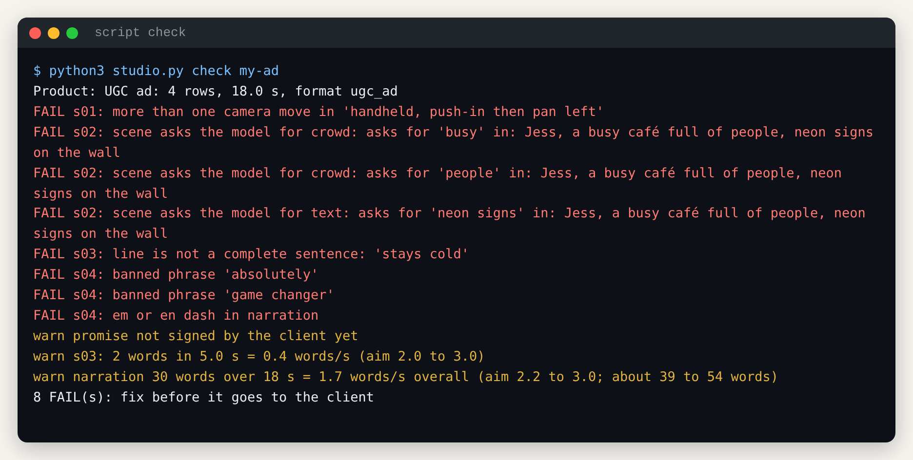

It also checks every prompt the kit will build from your rows. Crowds, signs, menus, number plates, two-way traffic and
object physics are blocked, because the models get them wrong:

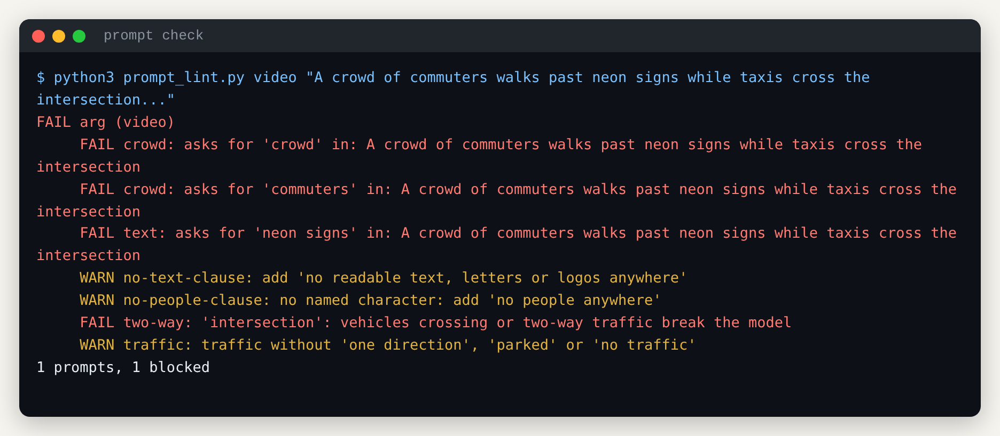

On the review page the script, the signed promise, the three concepts and the shot table sit together, with
**Approve** and **Ask for changes** buttons:

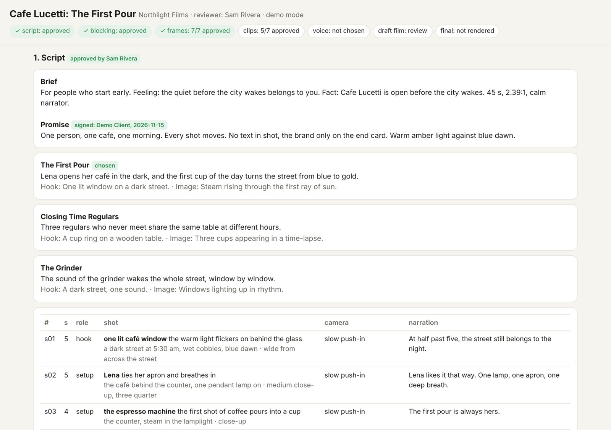

### 2. Plan who stands and walks where (blocking)

Video models move people in odd ways: they walk through furniture, swap places, or vanish at the edge of the frame.
So before any picture exists, you draw the room once and place the camera and the people for each shot:

```json
"sets": {"cafe": {"size": [9, 6], "items": [
  {"name": "window", "x": 0, "y": 0, "w": 9, "d": 0.15, "kind": "window"},
  {"name": "counter", "x": 1, "y": 1.2, "w": 3.6, "d": 0.8},
  {"name": "table 2", "x": 7.2, "y": 3.2, "w": 1.0, "d": 1.0},
  {"name": "door", "x": 8.85, "y": 4.6, "w": 0.15, "d": 1.0, "kind": "door"}]}}
```

```json
"blocking": {"set": "cafe",
  "camera": {"x": 2.0, "y": 5.6, "aim": [8.0, 4.6], "pan_to": [3.8, 2.2], "lens": 28, "move": "pan"},
  "people": [{"name": "Tom", "from": [8.6, 5.1], "via": [[7.0, 4.8], [5.0, 3.4]], "to": [3.8, 2.6]},
             {"name": "Lena", "at": [2.8, 2.4], "facing": [3.8, 2.6]}]}
```

```bash
python3 studio.py blocking my-ad
```

Each shot becomes a top-view drawing: the camera and what it sees (yellow, blue for the end of a pan), every person,
and the footsteps of anyone who walks.

| A walk along the counter | A pan that follows Tom from the door |
|---|---|
| 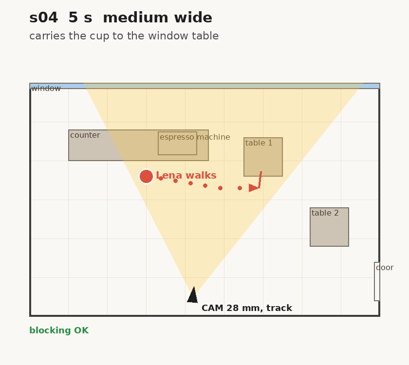 | 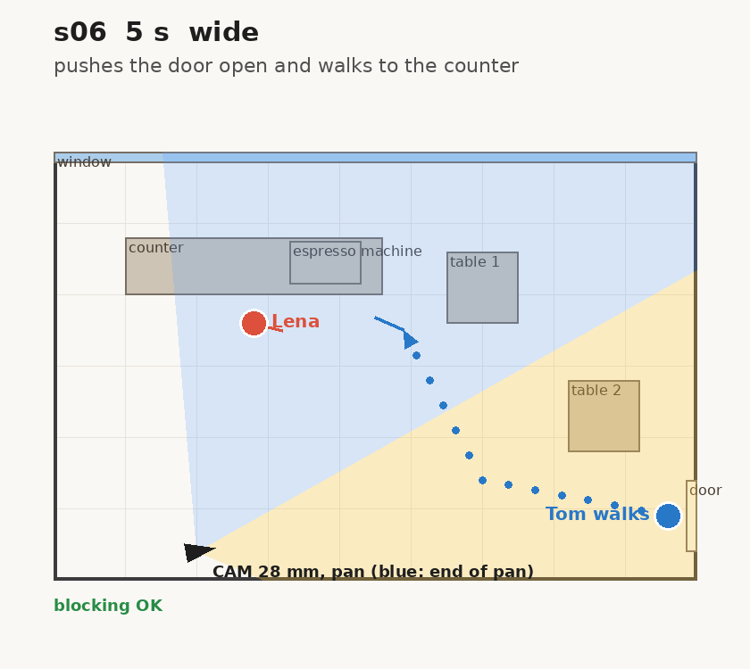 |

The check catches mistakes before they cost anything. Here Tom's path goes straight through a table, two people walk at
once, and the camera does not see either of them:

| The drawing | The check |
|---|---|
| 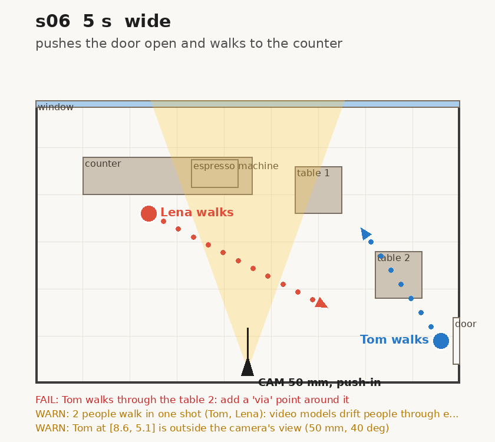 | 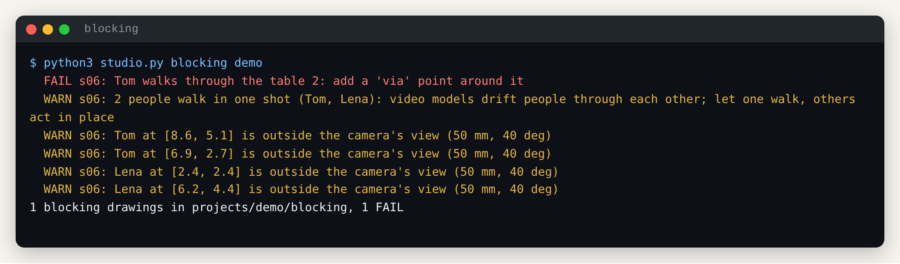 |

All shots side by side, for the review page:

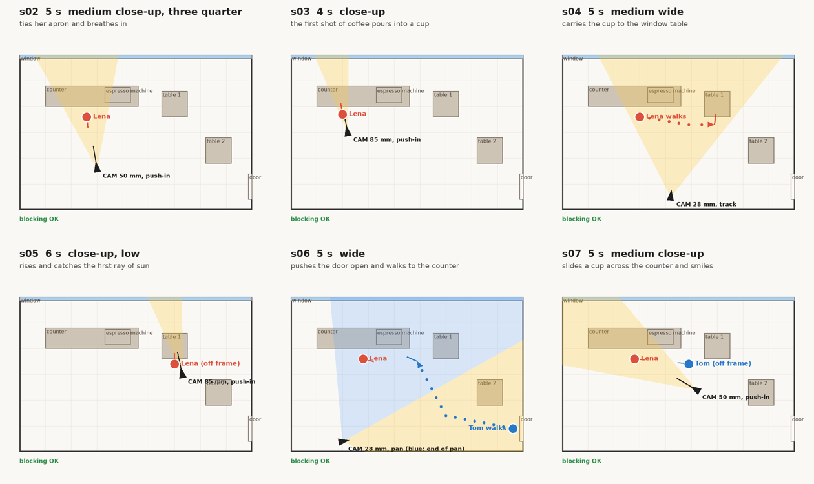

The blocking also goes into the frame prompts in plain words, worked out from the camera geometry
("Positions: Tom in the center of the frame, in the background; Lena on the left of the frame, in the foreground").

### 3. Start frames

```bash
python3 studio.py frames my-ad
```

The kit builds one prompt per shot from the row, the character looks, the blocking and your style line, checks it,
and shows the cost first. With more than three frames to make, it generates **one sample** and stops until you
approve it:

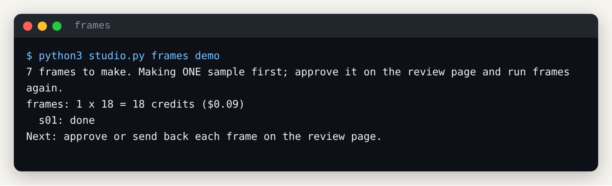

Approve each frame, or write what should change. The note is added to the next prompt for that frame, the old version
is kept in `frames/old/`, and the page shows the version number:


What sending a frame back looks like in practice. Both first versions had writing in them (a number plate, shop signs,
neon), which video models turn into garbled letters. The note asked for a remake without people or signs:

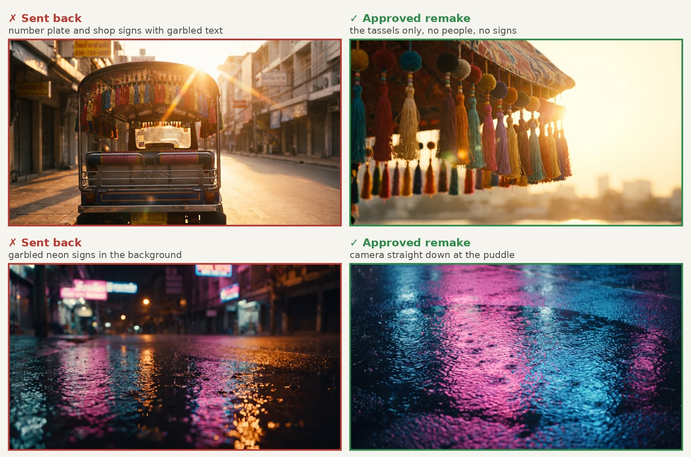

The first approved frame of each character is passed as a reference to every later frame with that character, so faces
and clothes stay the same across shots.

### 4. Video takes

```bash
python3 studio.py takes my-ad
```

Four 480p draft takes per approved frame (set the number with `--n`). Every take goes through the clip check, which
measures motion frame by frame and flags pop-ins, morphing, opposite motion streams, sudden jumps and garbled text:

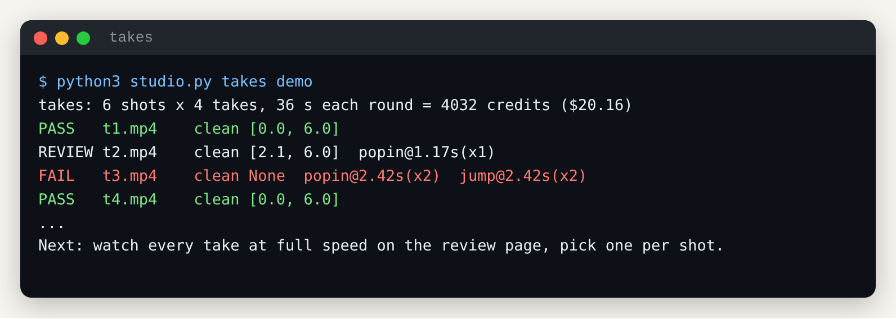

Each flagged take gets a frame strip with the bad moments marked in red, so you know exactly where to look.
Two real catches:

**A smoke cloud that balloons out of nothing** (flagged as a pop-in at 1.0 s; the clean part starts at 1.25 s):

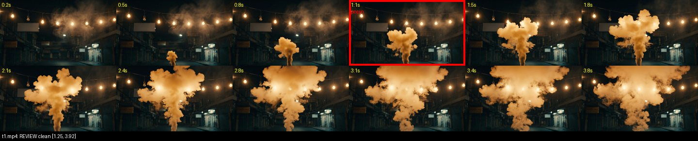

**The road changing under the camera**: an overpass appears and the street swaps at 2.8 s, a take that is unusable
(FAIL, no clean range). This shot was re-rolled until all traffic moved one way:

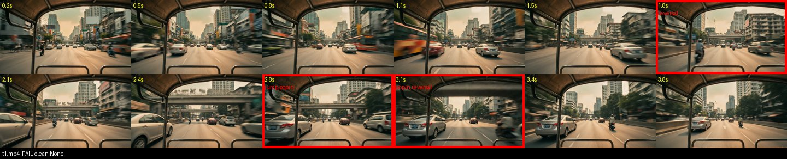

On the review page you watch every take at full speed, click the best one and approve it. Here the smoke shot has three
takes: two with the smoke pop-in (REVIEW) and one clean take (PASS), which the reviewer picks:

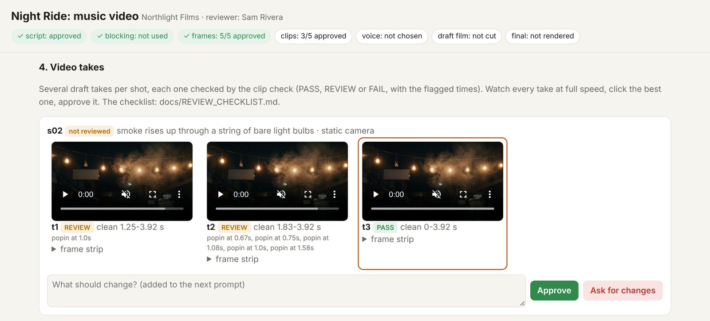

From an approved frame to the approved clip:

| Start frame | Approved clip |
|---|---|
|  | [](docs/examples/clip_C88.mp4) |
|  | [](docs/examples/clip_C75.mp4) |

The check flags; a person decides. It flagged the swinging tassels as a direction reversal and the rain rings as
crossing motion. The reviewer watched both at full speed, saw natural motion, and passed them.

Pending shots sit at the top; approved shots collapse to the chosen take. The checklist for reviewers is
[docs/REVIEW_CHECKLIST.md](docs/REVIEW_CHECKLIST.md): the clip check catches about two thirds of the defects people
reject, so a human look is still part of the job.

### 5. Narrator and score

```bash
python3 studio.py voices my-ad
```

Every candidate narrator reads the first lines of your script. Listen and pick by ear: a label like "British" or
"American" is not proof of how a voice sounds. Then:

```bash
python3 studio.py vo my-ad
```

```bash
python3 studio.py music my-ad
```

The narration is recorded one file per shot, so each line lands on its own picture and a bad line is redone alone.
Brand names that a voice reads wrongly go in `"pronounce": {"AcmeHQ": "Acme H Q"}`. The score comes in two takes;
pick one.

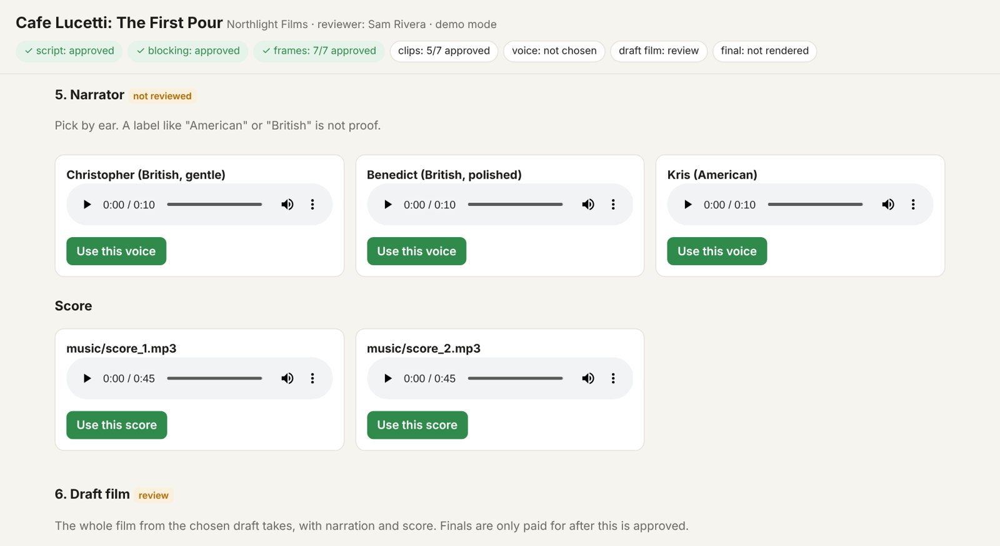

### 6. Draft film, then finals

```bash
python3 studio.py cut my-ad
```

The draft film puts the chosen takes in order, trims each to its row length (starting at the clean range the clip check
found), lays each narration line on its shot, ducks the score under the voice, adds the end card and the letterbox, and
applies the look grade once over the whole film.

Only after you approve the draft film:

```bash
python3 studio.py final my-ad
```

renders the same chosen takes again at 720p (or `--res 1080p`), from their draft task ids so the motion stays the same,
and cuts the final film into `projects/my-ad/cut/final.mp4`.

At any moment:

```bash
python3 studio.py status my-ad
```

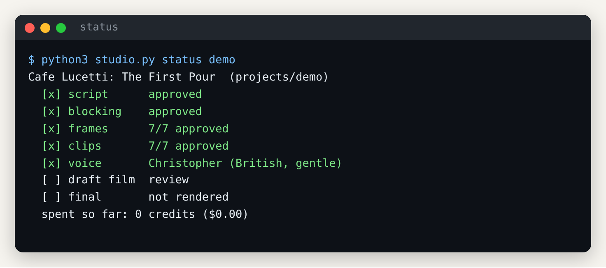

### Sharing the review page

The review page runs on your computer. To show it to a client, export a read-only copy and upload the folder anywhere
(a shared drive, any static host):

```bash
python3 studio.py review my-ad --export share/my-ad
```

---

## What it costs

Prices on kie.ai (November 2026, 200 credits = $1). The kit prints the estimate before every paid step and stops when
your balance does not cover it plus 10%.

| Item | Model | Price |
|---|---|---|
| Start frame, 2K | Nano Banana Pro | 18 credits ($0.09) |
| Video draft, 480p | Seedance 2.5 | 28 credits per second ($0.14/s) |
| Video final, 720p | Seedance 2.5 | 63 credits per second |
| Video final, 1080p | Seedance 2.5 | 158 credits per second |
| Music, two takes | Suno V4.5+ | about 12 credits |
| Narration | ElevenLabs | from your own ElevenLabs plan, about $0.08 per 1,000 characters |

Rough totals: a 20-second UGC ad is about $3 as drafts and $6 to $8 with 720p finals. A 60-second brand film with 4
draft takes per shot and 720p finals is about $40 to $65.

Three rules keep the spend in check (`ledger.py`):
- **Sample before batch**: more than three items in a step means one sample first, and the batch only after you approve it.
- **Three rounds per shot**: after three rounds a shot is redesigned in the script, not retried again.
- **Reserve**: nothing is submitted when the balance does not cover the estimate plus 10%.

For music videos, `plan_check.py` does the arithmetic before you write a single row: how many cuts the song asks for,
how many unique clips that needs, the expected retakes, and the total against your balance and budget:

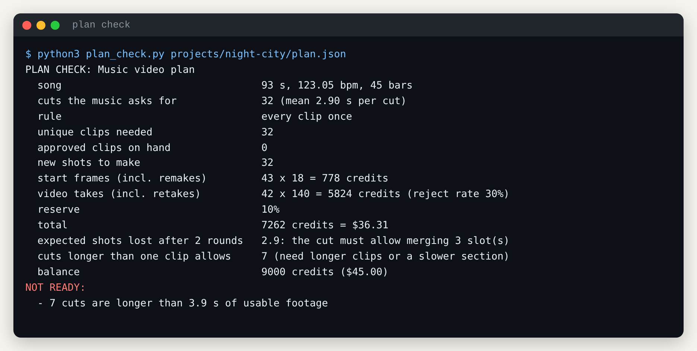

---

## The script format

`beats.json`, one file per project. The full guide is [docs/SCRIPTS.md](docs/SCRIPTS.md); the example is
[examples/first-pour/beats.json](examples/first-pour/beats.json).

```json
{
  "title": "Cafe Lucetti: The First Pour",
  "format": "brand_film",
  "brief": "For people who start early. Feeling: ... Fact: ... 45 s, 2.39:1, calm narrator.",
  "promise": {"text": "One person, one café, one morning. Every shot moves. No text in shot.", "signed": "Client name, date"},
  "looks": {"Lena": "a woman in her early thirties, fair skin with light freckles, dark blond hair in a low bun, rust linen apron"},
  "style": "Cinematic film still, 35 mm anamorphic lens, soft motivated light, gentle film grain, photoreal, 16:9.",
  "aspect": "2.39:1",
  "pronounce": {"AcmeHQ": "Acme H Q"},
  "music": {"style": "warm solo piano and soft strings, slow, hopeful, 72 bpm", "title": "First Pour"},
  "concepts": [{"title": "...", "logline": "...", "hook": "...", "image": "...", "fit": "..."}],
  "chosen": "The First Pour",
  "sets": {"cafe": {"size": [9, 6], "items": []}},
  "rows": [
    {"id": "s02", "seconds": 5, "role": "setup",
     "subject": "Lena", "subject_motion": "ties her apron and breathes in",
     "scene": "the café behind the counter, one pendant lamp on", "framing": "medium close-up, three quarter",
     "camera": "slow push-in", "intent": "this hour is hers",
     "vo": "Lena likes it that way. One lamp, one apron, one deep breath.",
     "blocking": {"set": "cafe", "camera": {"x": 2.6, "y": 4.4, "aim": [2.6, 2.4], "lens": 50, "move": "push-in"},
                  "people": [{"name": "Lena", "at": [2.6, 2.4], "facing": [2.6, 4.4]}]}},
    {"id": "s08", "seconds": 6, "role": "brand", "subject": "the end card", "subject_motion": "holds",
     "scene": "black", "framing": "full frame", "camera": "locked-off", "intent": "brand",
     "vo": "Cafe Lucetti. The first pour is yours.",
     "card": {"title": "Cafe Lucetti", "line": "The first pour is yours."}}
  ]
}
```

Tips that save the most money:
- Describe every character's age, hair, skin tone and outfit in `looks`. Vague looks drift between shots.
- One subject, one action, one camera move per row.
- No crowds, signs or writing in any scene. Add text in the edit with `onscreen_text`, never in the picture.
- Magic the model can draw itself (light, steam, weather, water); brand logos only on the end card.

---

## The extra tools

`studio.py` runs these for you, and each one also works on its own.

| Tool | What it does |
|---|---|
| `script_check.py` | Fails scripts with missing fields, two camera moves, crowds or writing in a scene, incomplete lines, banned phrases; warns on narration speed and repeated words |
| `prompt_lint.py` | Blocks prompts that ask for what video models do badly; allows the same words when negated ("no people") |
| `blocking.py` | Top-view drawings per shot with camera cone, paths and collision checks; turns the plan into prompt words |
| `clip_qa.py` | Measures every take for pop-ins, morphing, crossing motion, reversals, jumps, text and people; writes a frame strip |
| `look.py` | One look per project: palette, lens, hero stills per light state, drift check across a batch, one final grade |
| `audiomap.py` | Song map for music videos: tempo, bars, energy, sections, drops, and how often to cut in each part |
| `plan_check.py` | Cuts vs unique clips vs retakes vs credits, before generating anything |
| `diversity.py` | Finds look-alike neighbors and flat stretches in a music-video cut and swaps them |
| `ledger.py` | Estimates, real spend, reject rates per model, decisions; enforces the spending rules |

The song map for a music video, made from the audio itself:

```bash
python3 audiomap.py song.mp3 projects/night-city/audiomap.json --png projects/night-city/audiomap.png
```

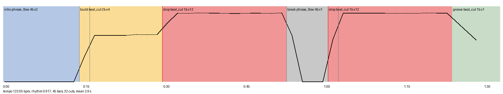

Quiet intros and breaks get long shots (every 4 bars), builds get a cut every 2 bars, drops a cut on every bar, and the
strongest shots go on the drops.

A shared look for a project (`look.json`, created with `python3 look.py new projects/my-ad`): every frame prompt then
starts with the palette, lens and film stock, the approved hero still goes in as reference image 1, and the grade runs
once over the finished film.

---

## Folder layout

```text
ai-video-studio-kit/
├── studio.py             the command line: setup, new, check, blocking, review, frames, takes, voices, vo, music, cut, final, status
├── review_server.py      the review page (review_page.html) and the static export
├── cut.py                the edit: takes, narration, ducked score, end card, letterbox, grade
├── kie.py  voice.py      the kie.ai and ElevenLabs clients
├── *.py                  the checks and tools listed above
├── templates/            beats_brand_film.json, beats_ugc_ad.json, beats_music_video.json, plan.json
├── examples/first-pour/  the example film script with blocking
├── docs/                 SCRIPTS.md, REVIEW_CHECKLIST.md, images
└── projects/<name>/      your films (not in git)
    ├── beats.json        the script
    ├── approvals.json    every decision: who, when, approved or changes, the note
    ├── ledger.jsonl      estimates, spend, outcomes
    ├── blocking/         top-view drawings
    ├── frames/           start frames, their prompts, older versions in old/
    ├── takes/<shot>/     t1.mp4 ... with .qa.json and .qa.jpg per take
    ├── vo/               samples/ and lines/
    ├── music/            score takes
    ├── finals/           final-resolution takes
    └── cut/              draft.mp4 and final.mp4
```

### Working with Claude Code

The repo includes a `CLAUDE.md` with the same gates and rules, so you can ask Claude Code to draft a script, fix a
failing check or set up the blocking, while the approvals stay with you.

---

## Troubleshooting

| Problem | Fix |
|---|---|
| `WAITING: the script is not approved yet` | Open the review page and approve the step it names |
| `STOPPED: ... without an approved sample` | Approve the one sample on the review page, then run the command again |
| `STOPPED: balance ... < estimate` | Top up kie.ai, or make fewer shots or takes (`--n 2`) |
| `BLOCKED by prompt check` | Rewrite the row: remove the crowd, sign or physics it names, or negate it ("no people") |
| `kie.ai: could not read the balance` | Check the key with `python3 studio.py setup`; new keys can take a minute |
| A take keeps failing the clip check | After three rounds, change the shot in the script: simpler action, closer framing |
| A narration line sounds wrong | Rephrase it in `beats.json` and run `studio.py vo` again |
| The browser does not play a take | The page streams from your computer; reload, or open the mp4 from `projects/<name>/takes/` |
| ffmpeg not found | macOS: `brew install ffmpeg`. Linux: `sudo apt-get install ffmpeg` |

Questions or access requests: open an issue in this repository.

---

## License and ownership

AI Video Studio Kit is owned by Giovanni Brees. Copyright (c) 2026 Giovanni Brees. All rights reserved.

This is proprietary software, not open source. People invited to this repository may install and use it to make their
own videos for as long as they have access. Copying, sharing, publishing, forking into public repositories, reselling,
or building other products from it requires written permission from Giovanni Brees. The videos you make with it are
yours. The full terms are in [LICENSE](LICENSE).
